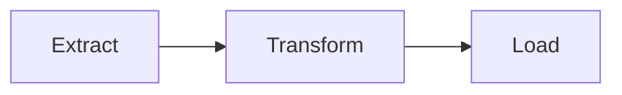

---
paths:
  - "**/*.md"
  - "**/docs/**"
---

# Documentation — Mermaid diagrams

Companion to `rules/common/documentation.md`.

## When to use a diagram — Mermaid.js when a picture outperforms text

A diagram is justified when it replaces several paragraphs of prose that would still leave the reader reconstructing a mental model. It is not justified when a short paragraph or a code snippet already makes the point clearly.

**Use a Mermaid diagram when:**
- **Architecture overview** (`docs/architecture.md`): component boundaries, service interactions, data flow across more than 2–3 modules — a `graph TD` or `C4Context` diagram beats a bullet list every time.
- **Sequence / protocol**: multi-step interactions between actors (API calls, auth flows, pipeline stages) — `sequenceDiagram` makes the ordering unambiguous without enumerating 10 numbered steps.
- **State machine**: an entity with multiple states and guarded transitions (`stateDiagram-v2`) — state tables are harder to scan than a visual graph.
- **Class hierarchy / domain model**: when there are 4+ classes with non-trivial relationships — `classDiagram` documents the OOP design alongside the code.
- **Data pipeline / ETL flow**: extraction → transformation → load stages with branching — `flowchart LR` makes the topology immediately readable.
- **ADRs in `docs/decisions/`**: if the decision involves a before/after architecture, add both diagrams; they make the trade-off visceral in a way prose can't.

**Do NOT add a diagram when:**
- A single sentence or a short list already communicates the same information clearly.
- The project has only 1–2 modules — a diagram would add complexity, not clarity.
- The diagram would just mirror the file tree (no topology, no interaction shown).

**Diagram type cheat sheet:**

| Situation | Mermaid type |
|---|---|
| General flow / architecture | `flowchart TD` / `flowchart LR` |
| Multi-actor interactions | `sequenceDiagram` |
| States & transitions | `stateDiagram-v2` |
| Class relationships | `classDiagram` |
| Timeline / Gantt | `gantt` |
| ER / data model | `erDiagram` |

**Validation with the Mermaid MCP:**
The `mcp__claude_ai_Mermaid_Chart__validate_and_render_mermaid_diagram` tool is available. Use it to validate any Mermaid block before including it in a doc — a syntax error in a diagram renders as a broken image, which is worse than no diagram. Always validate before considering the doc done.

**Format in Markdown:**
Always use a fenced code block with the `mermaid` language tag:

````markdown

````

Diagrams live in the doc file closest to what they describe — `docs/architecture.md` for the global picture, a specific `docs/decisions/` ADR for a localized one. Never create a `docs/diagrams/` folder that just holds `.md` files with diagrams and nothing else.

